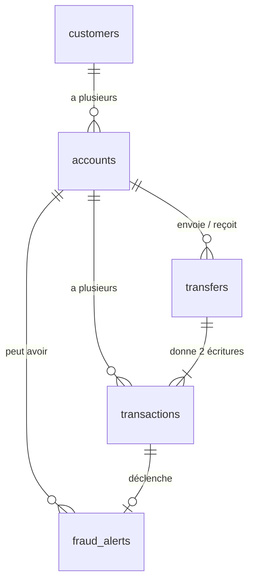
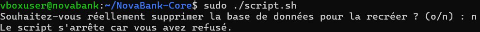
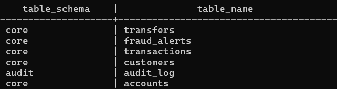
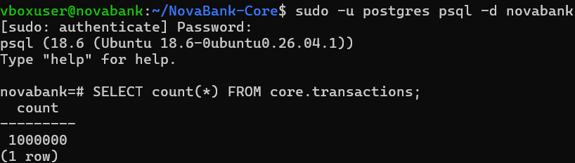
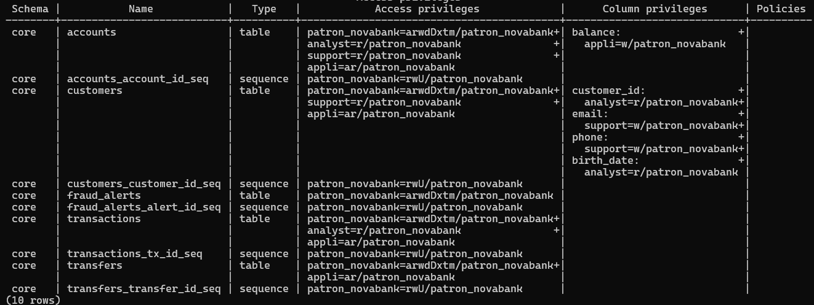
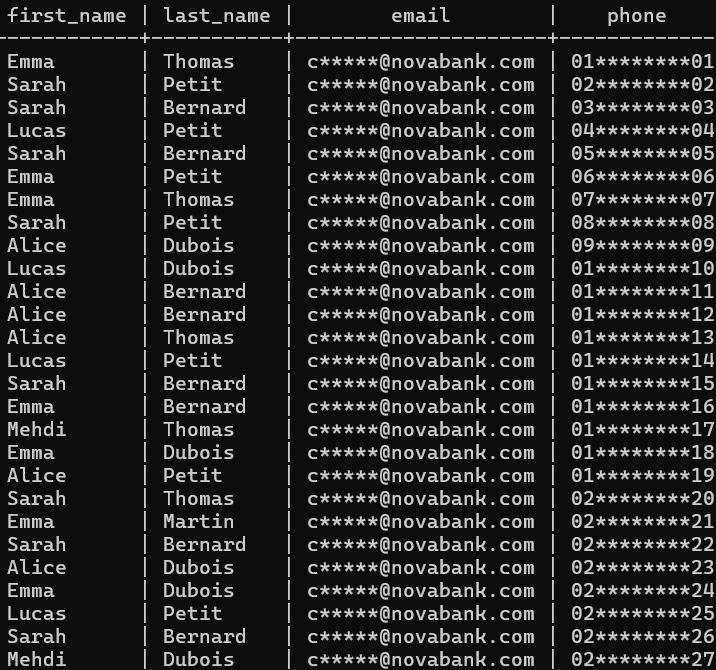
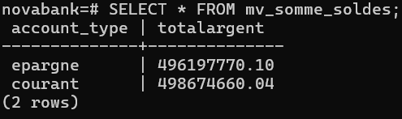
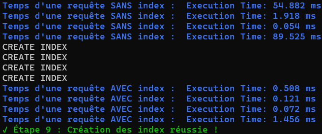

# NovaBank

<p align="center">
  
</p>

## Description

NovaBank Core est la base de données d'une banque en ligne, faite sur une VM Linux avec PostgreSQL dans le cadre du module SQL avancé et administration PostgreSQL.

Un seul script (`script.sh`) refait tout de zéro : installation de PostgreSQL, pare-feu, base, tables, données, droits, vues, index, triggers et procédures.

<hr>

## Technologies (Stack)

- **Ubuntu Server** dans une VM VirtualBox
- **PostgreSQL 18**
- **SQL et PL/pgSQL** pour les tables, les droits, les vues, les triggers et les procédures
- **Bash** pour le script d'installation et le script de sauvegarde
- **ufw** et **pg_hba.conf** pour limiter qui peut se connecter

Schéma des tables :



La table `audit.audit_log` n'a pas de lien : elle reçoit une ligne à chaque modification d'un compte ou d'un client.

<hr>

## Prérequis

- Une VM **Ubuntu 26.04** (c'est la version avec laquelle j'ai testé, son paquet `postgresql` installe PostgreSQL 18) avec un accès à internet
- Un utilisateur qui peut utiliser `sudo`
- Une carte réseau privé hôte (host-only) pour se connecter depuis la machine hôte en SSH

Si la distribution installe une autre version de PostgreSQL, il faut changer `VERSION_POSTGRESQL` en haut de `script.sh`. Il faut au minimum la version 17 car `03_donnees.sql` utilise `random(min, max)`.

Aucun mot de passe n'est dans le dépôt : le script les demande pendant l'installation.

<hr>

## Guide d'installation

### 1. Récupérer le projet dans la VM

```bash
git clone https://github.com/Harld9/NovaBank-Core.git
cd NovaBank-Core
```

### 2. Vérifier le réseau privé

Le script autorise SSH (port 22) et PostgreSQL (port 5432) seulement depuis le réseau privé écrit en haut de `script.sh` :

```bash
RESEAU_PRIVE=192.168.56.0/24
```

`192.168.56.0/24` est le réseau privé hôte par défaut de VirtualBox. Avec VMware, le réseau est choisi au hasard à l'installation (par exemple `192.168.150.0/24`), il faut donc changer cette ligne. Pour trouver le réseau, dans la VM :

```bash
ip -br a
```

Si la carte privée a l'adresse `192.168.150.128/24`, le réseau est `192.168.150.0/24`.

Si le réseau n'est pas le bon, le script marche quand même mais on ne peut plus se connecter à la VM depuis la machine hôte.

### 3. Lancer le script

```bash
sudo ./script.sh
```

Le script demande une confirmation avant de supprimer la base si elle existe, puis il demande un mot de passe pour `patron_novabank`, `employe_analyst`, `employe_support`, `employe_appli` et `employe_auditeur`. Chaque étape réussie affiche un message vert et le script s'arrête à la première erreur.

### 4. Se connecter

```bash
sudo -u postgres psql -d novabank
```

Avec un profil (le mot de passe est demandé) :

```bash
psql -h localhost -U employe_support -d novabank
```

### 5. Les profils

| Compte | Profil | Ce qu'il peut faire |
|---|---|---|
| `employe_analyst` | analyste | Lire les comptes, les écritures, la date de naissance des clients et la vue matérialisée. Ses requêtes sont coupées au bout de 30 secondes |
| `employe_support` | support | Lire les clients seulement à travers la vue masquée `v_support`, modifier l'email et le téléphone |
| `employe_appli` | appli | Lire et ajouter des clients, comptes, virements et écritures, modifier le solde |
| `employe_auditeur` | auditeur | Lire le journal `audit.audit_log` et la vue matérialisée |

### 6. Utiliser les procédures

Exemples :

```sql
CALL virement_securise(1, 2, 150.00);
CALL ouverture_compte('courant', 1, 500.00);
CALL releve_compte(1, '2026-01-01', '2026-12-31');
```

### 7. Lancer les tests

```bash
sudo -u postgres psql -d novabank < sql/tests.sql
```

Chaque test affiche ce qui est attendu : `OK` si la commande doit marcher, `REFUS` si elle doit afficher une `ERROR`. Une `ERROR` sur un test `REFUS` est donc normale, c'est la preuve que l'interdit est bien bloqué. Les tests écrivent de vraies opérations dans la base (dépôts, virements, alertes), pour repartir d'une base propre il suffit de relancer `script.sh`.

Le timeout de l'analyste se teste à part car il marche seulement avec une vraie connexion :

```bash
psql -h localhost -U employe_analyst -d novabank -c "SELECT pg_sleep(40);"
```

La requête doit être coupée au bout de 30 secondes avec `canceling statement due to statement timeout`.

### 8. Sauvegarder la base

```bash
sudo ./sauvegarde.sh
```

Le script :

1. sauvegarde la base avec `pg_dump` dans `sauvegardes/novabank_<date>_<heure>.dump`
2. restaure cette sauvegarde dans une base temporaire `novabank_verif`
3. compare le nombre de lignes de chaque table entre les 2 bases
4. supprime la base temporaire

Si une table n'a pas le même nombre de lignes, le script affiche une erreur en rouge et s'arrête. Le dossier `sauvegardes/` n'est jamais envoyé sur GitHub (`.gitignore`).

<hr>

## Screenshots

Le script demande une confirmation avant de supprimer la base :



Les schémas et les tables sont créés :



Le million d'écritures :



Les droits de chaque profil :



La vue masquée du support :



La vue matérialisée avec la somme des soldes :



Le temps des requêtes avant et après les index :



<hr>

## Utilisation de l'IA

J'ai utilisé l'IA comme tuteur : je lui demandais de m'expliquer des notions, de m'aiguiller sur les façons de faire et de m'aider à comprendre mes erreurs. Je ne l'ai pas suivie aveuglément : je l'ai remise en question sur plusieurs de ses réponses et j'ai complété avec des recherches sur internet sur certaines pratiques.

J'ai écrit moi-même la plus grande partie du projet. À la fin, je lui ai demandé de relire le projet par rapport au sujet : elle a trouvé des bugs et a écrit une partie des corrections (le lien entre les virements et les écritures, l'ouverture de compte, la détection des fraudes et le relevé), le fichier de tests et la vérification de la sauvegarde. J'ai relu et testé chacune de ces modifications, j'ai refusé celles qui n'étaient pas de mon niveau, et je suis en mesure d'expliquer tout mon code.

<hr>

## Journal de bord

### Étape 0 : la VM

La VM a 2 cartes réseau. La carte NAT permet à la VM d'aller sur internet en passant par mon PC, dans un seul sens. La carte réseau privé hôte est un câble virtuel sans internet qui marche dans les 2 sens, c'est grâce à elle que je peux me connecter en SSH.

Pour le SSH, j'ai vérifié que le paquet est installé avec `dpkg -l | grep openssh-server` (`ii` veut dire installé), puis qu'il est actif avec `systemctl is-active ssh.socket` et `systemctl is-enabled ssh.socket`. Ensuite depuis PowerShell sur Windows : `ssh NomUserLinux@IPDuReseauPrive`.

Pour Git, j'ai vérifié qu'il est installé avec `dpkg -l | grep git`, puis `git config --global user.name` et `user.email` (avec une valeur on écrit, sans valeur on lit). J'ai connecté Git à GitHub en SSH avec une clé créée par `ssh-keygen`, puis testé avec `ssh git@github.com`.

Problème rencontré : la VM ne trouvait plus les noms de domaine (DNS) après avoir changé de réseau. Je l'ai réglé en faisant passer le DNS par ma machine hôte avec `.\VBoxManage.exe modifyvm "NomDeLaVM" --natdnshostresolver1 on`.

J'ai aussi ajouté un `.gitattributes` qui force les fins de ligne Linux, car un script Bash modifié sous Windows peut ne plus marcher dans la VM.

### Étape 1 : le serveur

Je teste chaque commande à la main dans la VM, et si elle marche je l'ajoute au script.

Le script commence par `set -euo pipefail` : `-e` arrête le script dès qu'une commande échoue, `-u` arrête le script si une variable n'existe pas, `-o pipefail` vérifie aussi les erreurs dans un `|`. Ensuite il vérifie qu'il est lancé en root, met à jour la liste des paquets et installe PostgreSQL et ufw avec `--yes` pour ne rien avoir à taper.

J'ai mis la version de PostgreSQL dans une variable au cas où elle change. Le script écrit `listen_addresses = '*'` dans `conf.d/listenaddresses.conf` pour que PostgreSQL écoute sur toutes les cartes réseau, car l'adresse dépend de la machine du correcteur. Ce n'est pas un risque car les connexions sont filtrées par `pg_hba.conf` et par ufw.

`pg_hba.conf` (Host-Based Authentication) c'est la liste des invités de PostgreSQL selon la machine d'origine de la connexion. J'y ai ajouté le réseau privé hôte avec un mot de passe obligatoire (`scram-sha-256`). La ligne `postgres peer` doit rester en premier sinon plus personne ne peut administrer la base. Le script réécrit tout le fichier à chaque lancement avec `cat >` et un heredoc, il est donc idempotent : j'ai vérifié dans `pg_hba_file_rules` que le résultat est le même peu importe le nombre de lancements.

ufw (Uncomplicated Firewall) est une interface simple du pare-feu de Linux. Tout est fermé en entrée (`default deny incoming`), tout est ouvert en sortie pour `apt-get` et GitHub, puis j'ouvre seulement les ports 22 et 5432 depuis le réseau privé. Le script vérifie ensuite que ufw est actif avec `ufw status | grep -q "Status: active"`.

J'ai ajouté des messages de réussite en couleur avec `echo -e` (sans oublier de remettre la couleur normale à la fin).

### Étape 2 : les tables et les données

Le script demande une confirmation, puis supprime et recrée la base `novabank` et les schémas `core` et `audit`. Un rôle `patron_novabank` est propriétaire de la base et de toutes les tables (`SET ROLE patron_novabank`) pour ne pas tout faire avec `postgres` qui a tous les droits.

Les 6 tables ont des types précis et des protections avec `CHECK`, `UNIQUE` et des clés étrangères : email unique et valide, client majeur, solde jamais négatif, IBAN unique, montant positif, 2 comptes différents pour un virement.

Les données sont fabriquées avec `generate_series` : 10 000 clients, 2 comptes par client, 100 000 virements avec leurs 2 écritures chacun, et 800 000 dépôts et retraits pour arriver à 1 000 000 d'écritures. Les soldes de départ et les `balance_after` de ces données sont tirés au hasard. Pour toutes les nouvelles opérations, c'est le trigger qui calcule le solde, donc elles sont toujours justes.

### Étape 3 : les droits

Personne ne peut se connecter par défaut (`REVOKE CONNECT ... FROM PUBLIC`). J'ai créé 4 groupes sans connexion (`analyst`, `support`, `appli`, `auditeur`) qui portent les droits, et 4 comptes (`employe_...`) qui se connectent et font partie d'un groupe. Le script demande un mot de passe pour chaque compte avec `\password`, et redemande tant que les 2 saisies ne sont pas pareilles (`until`).

J'ai donné les droits au minimum, parfois colonne par colonne. Au début le support pouvait lire toute la table des clients et donc voir les emails en clair : maintenant il passe par la vue masquée et peut seulement lire `customer_id` pour savoir quel client il modifie. J'ai aussi ajouté un `statement_timeout` de 30 secondes à l'analyste pour qu'une grosse requête ne ralentisse pas toute la base.

### Étape 4 : les vues

- `v_support` cache une partie de l'email et du téléphone (`c*****@novabank.com`, `01********01`)
- `v_comptes_actifs` est modifiable mais avec une limite : `WITH CHECK OPTION` refuse une modification qui ne respecte pas `status = 'actif'`
- `mv_somme_soldes` est une vue matérialisée : le résultat est enregistré sur le disque et se lit tout de suite, mais il ne se met pas à jour tout seul, il faut lancer `REFRESH MATERIALIZED VIEW mv_somme_soldes;`

### Étape 5 : les index

J'ai créé 4 index : l'historique d'un compte, les comptes d'un client, les virements d'un compte et les écritures par date. Le script mesure le temps de 4 requêtes avec `EXPLAIN ANALYZE` avant et après la création des index et l'affiche en bleu.

### Étape 6 : les triggers

- Le solde se met à jour tout seul à chaque écriture. Le trigger est en `BEFORE INSERT` car il remplit aussi `balance_after` avant que la ligne soit écrite. Si le solde passe sous 0, l'écriture est refusée.
- Le passé ne change plus : `UPDATE` et `DELETE` sont refusés sur `core.transactions`.
- Chaque modification d'un compte ou d'un client est notée dans `audit.audit_log` avec l'avant, l'après, qui et quand.
- Un retrait de 5 000 ou plus, ou 5 virements en 10 minutes depuis le même compte, créent une alerte dans `core.fraud_alerts`.

Problème rencontré : l'appli ne pouvait plus rien écrire car le trigger d'audit essayait d'écrire dans le schéma `audit` avec les droits de l'appli. Je l'ai réglé avec `SECURITY DEFINER` (la fonction tourne avec les droits de son propriétaire) et `session_user` pour garder le nom de la personne vraiment connectée.

Les triggers sont créés après l'insertion du million d'écritures pour que la création des données reste rapide.

### Étape 7 : les procédures

- `virement_securise` vérifie le montant et les comptes, verrouille les 2 comptes avec `SELECT ... FOR UPDATE` toujours dans le même ordre (le plus petit numéro d'abord) pour éviter les deadlocks, enregistre le virement dans `core.transfers` puis ses 2 écritures. Tout se fait ensemble ou rien n'est fait.
- `ouverture_compte` crée un compte actif avec son IBAN et enregistre le premier dépôt comme une écriture pour que le trigger mette le solde à jour.
- `releve_compte` affiche le solde de départ, chaque écriture de la période et le solde final.

Problèmes rencontrés : la boucle du relevé ne marchait pas car la variable `i` n'était pas déclarée en `record`, le virement et l'ouverture de compte plantaient car `balance_after` et `iban` étaient vides, et le relevé oubliait le dernier jour avec `BETWEEN`.

### Étape 8 : tests et rendu

- Le fichier `sql/tests.sql` teste chaque règle du sujet avec un cas qui marche et un cas qui doit être refusé.
- Le script `sauvegarde.sh` sauvegarde la base puis la restaure dans une base temporaire pour vérifier que la sauvegarde est bonne.
- Les captures d'écran du terminal et ce README.
